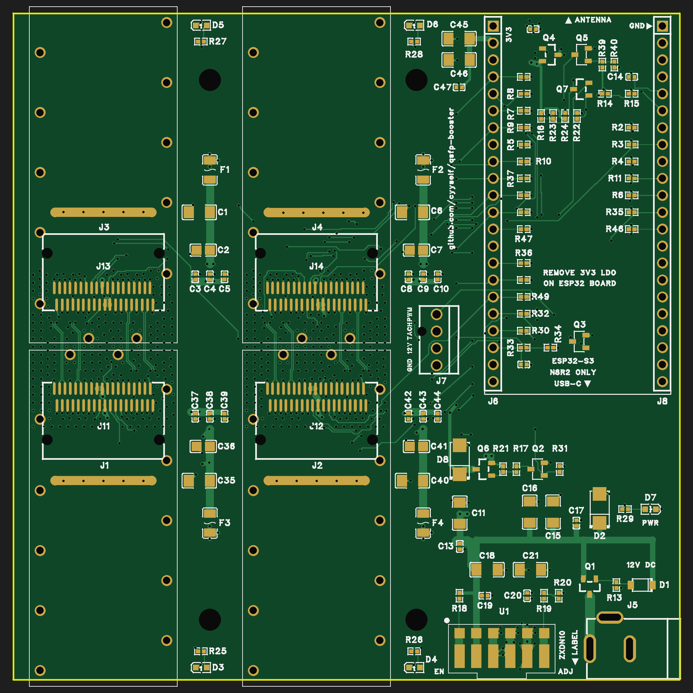
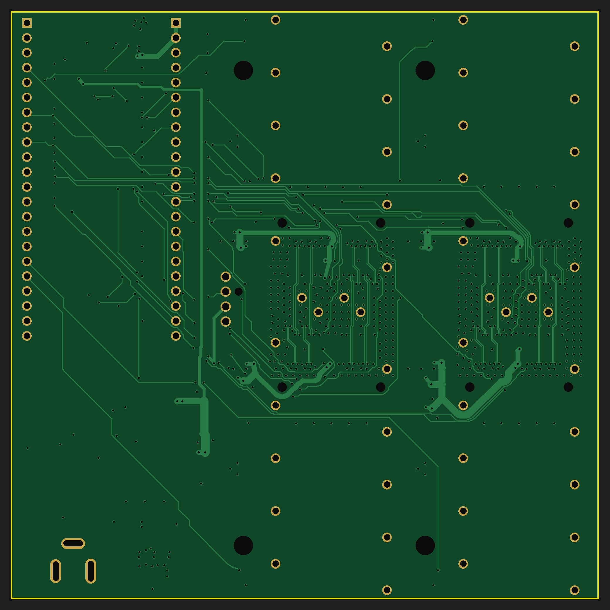

# QSFP Booster

A 2-port QSFP28 media converter board. Each port bridges a passive QSFP+/QSFP28 DAC cable from a
host NIC to a 40G/100G optical transceiver. The board powers the optical modules from its own 12 V
supply (up to Power Class 7 / 5 W each), so long-reach modules work even when the NIC cannot power
them. An ESP32-S3 manages the modules over I2C and runs the fan and status LEDs.

Bottom view (seen from below)

> **Status:** first prototype, not yet built or tested. Use at your own risk.

## Features

- **2 × (DAC receptacle → optical receptacle)** QSFP28 pairs. High-speed lanes are passed straight
  through (DAC Rx → optical Tx and optical Rx → DAC Tx) on 100 Ω differential pairs, with no
  retimer and no AC-coupling capacitors (QSFP28 modules and the NIC AC-couple internally).
- **Module power:** 12 V → 3.3 V by a hand-fitted ZXDN10 (ZXDN10S1205SAW) DC-DC module, mounted
  upright on the board edge, feeding each module through its own PPTC fuse.
- **Management:** a plug-in ESP32-S3 DevKitC-1 style board (N8R2 / N4R2 / no PSRAM) in two 22-pin
  sockets. Each module has its own I2C pins plus presence, reset and interrupt lines. The ESP32 board's
  own USB-C ports are used for flashing and the console (with 12 V applied; remove the board's 3.3 V regulator first,
  see the service rules).
- **Cooling:** 4-pin PWM fan header with a high-side switch that can turn the fan fully off, plus
  tachometer input. The fan only runs when the ESP32 turns it on (off with no MCU or during reset).
- **Cages:** the same press-fit cage on all four ports, each with an exposed ground strip under its
  EMI fingers.
- **Indicators:** one LED per port and a power LED, spaced along the board edges.
- **Input protection:** reverse-polarity P-MOSFET and SMAJ12A surge suppressor.
- **Board:** 100 × 100 mm, 4 layers.

## Specifications

| Item | Value |
|---|---|
| Input | 12 V DC ± 5 % (11.4–12.6 V), 3 A, barrel jack (centre positive) |
| Module power | 3.3 V, up to 5 W per optical module (SFF-8679 Power Class 7); 11 W firmware budget, 10.5 W supported configuration (two 5 W optics + two passive DACs) |
| PCB | 100 × 100 mm, 4 layers, 1.6 mm, JLCPCB stack-up JLC04161H-3313 with impedance control |
| Differential pairs | 100 Ω, 0.13 mm trace / 0.15 mm gap on the outer layers |
| Vias | 0.3 mm drill / 0.45 mm pad |

## Repository contents

| Path | What it is |
|---|---|
| `hardware/qsfp-booster.epro` | JLCEDA Pro (嘉立创EDA专业版) project in epro (V2) format: schematic and PCB (source of truth). KiCad 8+ can import it via File → Import → Non-KiCad Board File |
| `docs/design-spec.md` | Original design specification (the pin map above and the project file reflect the final board where they differ) |

Production files are attached to each [GitHub release](../../releases):

| File | What it is |
|---|---|
| `Gerber_qsfp-booster.zip` | Gerber and drill files |
| `BOM_qsfp-booster.xlsx` | Bill of materials with LCSC part numbers (JLCPCB assembly) |
| `CPL_qsfp-booster.xlsx` | Component placement (pick-and-place) file, top side |

## Ordering at JLCPCB

1. Download the production files from the latest release and upload `Gerber_qsfp-booster.zip`.
2. PCB options:
   - **Layers:** 4.
   - **Thickness:** 1.6 mm.
   - **Impedance control:** yes, stack-up **JLC04161H-3313**.
   - **Min via hole size:** **0.3 mm** (the free option).
3. Enable PCB assembly (standard PCBA, top side), then upload `BOM_qsfp-booster.xlsx` and
   `CPL_qsfp-booster.xlsx`.
   In the assembly preview, check the parts by their LCSC number rather than the CPL "Device" name, which
   is stale for some resistors: R23 must be **C11702** (1 kΩ) and R25–R30 **C25076** (100 Ω).
4. Hand-solder the parts that are not in the BOM:

   | Ref | Part | LCSC |
   |---|---|---|
   | J5 | DC-005 barrel jack (XKB DC-005-5A-2.0) | C381116 |
   | J7 | 4-pin fan header (Molex 47053-1000) | C240840 |
   | J6, J8 | 22-pin 2.54 mm female headers for the ESP32-S3 board | — |
   | U1 | ZXDN10 (ZXDN10S1205SAW) 12 V → 3.3 V module, upright, label facing the board edge | salvaged |
   | J11–J14 | QSFP28 1×1 cages, press-fit (CND-tek QSFP28 2170703-2 1X1H), all four ports | C52677971 |

   Use this cage on every port. Heatsink cages such as TE 1888631-1 have their two rear press-fit
   pins 10.6 mm behind the connector alignment holes, while this board drills them at 12.79 mm, so
   they will not fit. The optical modules are cooled by the fan through the cage's top window; a
   clip-on QSFP heatsink can be added if needed.

To change the design, open `hardware/qsfp-booster.epro` in JLCEDA Pro (File → Open Project) and
regenerate the production files from there (File → Export).

## ESP32-S3 I/O map

The MCU is a plug-in **ESP32-S3 DevKitC-1 style board, N8R2 / N4R2 or no-PSRAM** (IO35–IO37 are used, which
octal-PSRAM "R8" boards reserve). Pins were assigned so each signal takes the shortest, non-crossing route to
its QSFP connector, so a port's pins are not consecutive.

| Port | SDA | SCL | ModPrsL | IntL | ResetL | LED |
|---|---|---|---|---|---|---|
| DAC1 | IO3 | IO35 | IO37 | IO17 | IO36 | IO47 |
| DAC2 | IO11 | IO10 | IO8 | IO18 | IO9 | IO21 |
| OPT1 | IO41 | IO4 | IO39 | IO15 | IO40 | IO1 |
| OPT2 | IO5 | IO6 | IO16 | IO38 | IO7 | IO42 |

| Function | GPIO |
|---|---|
| Fan PWM / power enable / tach | IO12 / IO13 / IO14 |
| 12 V input sense (ADC1) | IO2 |
| Unused (dev-board functions) | IO0 BOOT, IO19/IO20 native USB, IO43/IO44 UART console, IO45/IO46 straps, IO48 RGB LED |

Each port has its own SDA/SCL pair with 4.7 kΩ pull-ups; the two ESP32 I2C controllers are moved between
ports in firmware (DAC ports on one controller, optical ports on the other). ModSelL and LPMode are tied low;
high-power classes are granted over I2C (byte 93) within a 5 W per-port and 11 W total budget.

## Power-up and service rules

- **ESP32 board preparation: remove its 3.3 V regulator.** On the YD-ESP32-S3 (and similar) board, desolder
  the **5 V → 3.3 V LDO** (CJ6107A33GW, SOT-223: its input is the board's 5 V, its tab/output is the 3V3 rail),
  and **leave the board's IN-OUT jumper open**. If that jumper were bridged on a board without its regulator, the
  USB-sense backup (Q7) would see USB 5 V and turn Q4's channel off: the ESP32 would then be fed only through
  Q4's body diode (a diode drop below 3.3 V) and may brown out. Do not bridge it.
  These steps are validated for the YD-ESP32-S3 V1.4; check the schematic of any other board first. The ESP32 then gets its 3.3 V only from this board, through
  Q4, which Q5 closes while 12 V is present, so USB can never create a second 3.3 V source. USB data (flashing,
  console) still works, but the ESP32 only runs while 12 V is applied. Espressif treats USB and 3V3-pin power as
  mutually exclusive, and an unmodified board's regulator (3.34 V measured) would otherwise sit in parallel with the
  ZXDN10 (3.36 V nominal) whenever USB is plugged in with 12 V on.
- **Backup for an unmodified ESP32 board:** Q7 senses USB 5 V on the board's 5V pin (J6.21) and opens Q4. This
  only works on boards whose 5V pin carries USB 5 V (e.g. Espressif DevKitC-1). On the YD board the pin is behind a
  diode unless its IN-OUT jumper is bridged, so there it does nothing: remove the regulator instead.
- **First power-up of every board:** with no ESP32 board and no modules fitted, apply 12 V and measure the
  3.3 V rail across C21. It must read about 3.3–3.4 V before anything else is plugged in. The ZXDN10's
  output is set by R19 + R20 (363 Ω, Vout = 0.591 × (3580 + R) / (330 + R) ≈ 3.36 V); a short there gives
  6.4 V, which would destroy the optics and the ESP32. Do not probe the ADJ resistors with power on.
- **12 V jack:** centre positive, a regulated 12 V ± 5 % (11.4–12.6 V), 3 A. Do not go higher: the SMAJ12A
  surge suppressor across the input is rated for 12.0 V continuous (stand-off) and breaks down from 13.3 V, so
  a supply at the top of the range already sits slightly above its stand-off rating. Prefer a supply close to
  12.0 V, and check D2 stays cold on the first board.
- **Fan (J7):** GND, 12V, TACH, PWM (silkscreened). The fan's 12 V is switched on the high side (Q6), so its
  ground is always connected. The fan is off unless the ESP32 is running and turns it on. Use a fan drawing
  at most 1 A (start-up included); the switched 12 V feed is routed for that.
- **Web UI:** plain HTTP with Basic auth, user `admin`. It stays off until a password is set over the UART
  (`passwd <new password>`); `passwd reset` turns it off again. Use it only on a trusted, isolated management
  network.
- **Supported module configuration:** passive DAC cables on the DAC ports (J1/J2) and optics up to 5 W (power
  class 7) on the optical ports (J3/J4), 10.5 W in all. The firmware puts anything else into SFF-8636 low-power
  mode once it has identified it (a non-passive module in a DAC port, class 8, or anything over the budget), but
  it cannot limit a module's draw before identification, so stay within this configuration.

## Usage notes

- The NIC sees a passive copper cable, so it will try copper auto-negotiation and link training,
  which the optical module never answers. Force the link instead, for example
  `ethtool -s <if> autoneg off speed 100000`, and set the same FEC mode on both ends.
- Keep the DAC cables short (about 0.5 m). The NIC drives the cable with copper equalisation, and a
  little cable loss brings the signal into the range the optical module expects.

## Known limitations

Independent reviews of the production files found the following. None of them stops the board from
working, but they are worth knowing before you rely on it:

- **Salvaged power module:** the ZXDN10 has no published ratings and no output overvoltage protection on
  this board; qualify each module (see the first power-up rule) and keep the total optics load within the
  11 W budget.
- **Port fault isolation:** each module is fed through a PPTC fuse (2.5 A hold, 5 A trip), not an
  eFuse. A shorted module can pull the shared 3.3 V rail down for all ports until the fault is removed: how fast
  (or whether) its fuse trips depends on the fault current and on how the salvaged ZXDN10 behaves in overload, so
  automatic clearing is not guaranteed. The fuse's hold current also drops with temperature (about 1.5 A at 70 °C,
  close to a 5 W module's 1.52 A), so keep the board well ventilated with high-power optics.
- **Module supply filtering:** the per-port bulk and bypass capacitors sit about 14 mm from the
  connector (the cage covers the area right next to it), and there is no SFF-8679 style per-pin
  filter.
- **High-speed channel:** every 25G lane goes top → bottom → top (two vias) between the connectors, and the CND-tek
  connector is sold as QSFP+. Expect to qualify each link with the real DAC and optics.
- **Web security:** no TLS (see the service rules).
- **Power budget:** the 10.5 W supported configuration is enforced by firmware only after a module is
  identified, and only per arriving module; other populations are best effort (see the service rules).

## License

[MIT](LICENSE)
